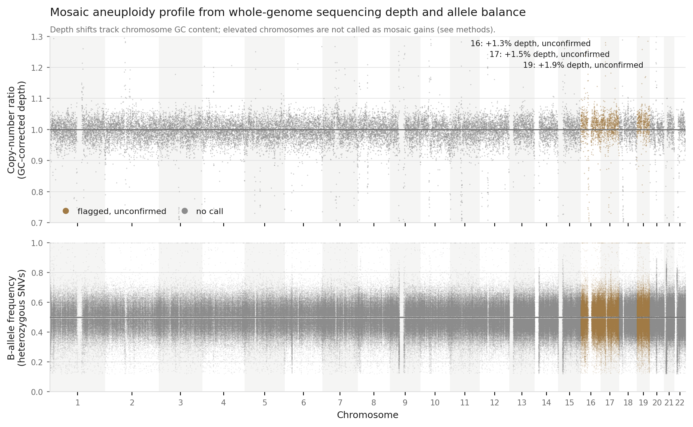

# Read-level re-analysis of a child's genome: compound-heterozygous BUB1B variants in mosaic variegated aneuploidy

**Track 1 report · Rare Disease, Real Kid: MVA Hackathon 2026**
Santiago Marin Martinez (Hugging Face / GitHub: smarin00) · 24 October 2026
Submission: `findings/track1/submission_full.csv` (final Track 1 submission) · Code: <https://github.com/smarin00/mva-hackathon-2026>

> **Summary.** The child's whole-genome reads were re-aligned and re-called
> independently of the vendor, then prioritised by phenotype with Exomiser. **BUB1B**
> ranked first by a wide margin. The primary prediction is a compound-heterozygous pair
> in *BUB1B*: a stop-gain, p.Leu737\*, and an extremely rare missense change in the
> pseudokinase domain, p.Asn1002Lys, submitted together on one row with each allele also
> listed singly. Biallelic *BUB1B* variants cause mosaic variegated aneuploidy type 1
> (MVA1), and one truncating plus one missense allele is the genotype pattern reported in
> MVA1. DeepVariant recovered both alleles from the reads at germline allele fractions;
> read-backed phasing could not resolve whether they lie in trans. Read-level checks
> found no mosaic, structural or repeat-expansion variant in or near *BUB1B*, and no
> confirmed chromosome-level dosage change. One secondary finding (LZTR1) is reported.
> The automatic submission rules alone produce the same four variants; a clean rerun of
> the whole pipeline reproduced the submission byte for byte.

*Note.* An earlier submission (6 October 2026) ranked the provided vendor VCF with
Exomiser alone. This report describes the final, read-level submission.

## 1. Case and data

The child presented with rhabdomyosarcoma (HPO HP:0002859), the oncological event that
triggered the genetic investigation.

| Input | Use |
|---|---|
| Raw reads | Four lanes of paired-end whole-genome FASTQ: the basis of this submission |
| Phenotype | HPO terms from the clinical phenotype document, each checked against the current HPO release (`pyhpo`) |
| Vendor VCF | Not used for this submission (basis of the earlier one); both causal alleles are also present in it |

## 2. Pipeline

One Nextflow workflow (`make all` with `mode: full` in the case file `params.yaml`) on
GRCh38, no-alt analysis set with hs38d1 decoys.

| Step | Tool (version) | Output used |
|---|---|---|
| Read QC and trimming | fastp 1.0.1 [1] | per lane |
| Alignment | bwa-mem 0.7.19 [2], per lane; merge, sort, duplicate marking (samtools) | CRAM |
| Coverage | mosdepth 0.3.14 [3] | depth QC, aneuploidy |
| Variant calling | DeepVariant 1.10.0 [4], primary chromosomes | germline SNVs and indels |
| Normalisation | bcftools: PASS only, primary contigs, multiallelic split, left-aligned | input to ranking |
| Prioritisation | Exomiser 15.1.0 [5, 6], data 2602 (settings below) | ranked candidates |
| Phasing | WhatsHap 2.8 [7], candidate-gene panel | phase of candidate pairs |
| Mosaic variants | GATK 4.7.0.0 Mutect2 [8], candidate-gene panel | low-fraction SNVs and indels |
| Structural variants | Delly 2.7.0 [9] | SVs |
| Repeat expansions | ExpansionHunter 5.0.0 [10], GRCh38 catalogue; sex from chrY/chrX depth | STR genotypes |
| Aneuploidy | depth and B-allele fraction per chromosome, three GC-correction models (`bin/aneuploidy_plot.py`) | per-chromosome dosage |
| Annotation | Ensembl VEP 116.2 [11] with AlphaMissense [12] and ClinVar 2026-10-04 | candidate review |

The candidate-gene panel (132 MVA, spindle-checkpoint, kinetochore, centromere,
cohesion, APC/C and microcephaly genes) is listed in `docs/panel_genes.txt`.

**Exomiser settings.** Analysis mode PASS_ONLY; coding and splice-region effects;
maximum population frequency 2% (gnomAD v4.1, UK10K); pathogenicity sources REVEL,
MVP, AlphaMissense and SpliceAI; all inheritance modes; hiPHIVE (human, mouse and
zebrafish phenotypes and protein interactions) and OMIM prioritisers.

## 3. Submission construction and EPCR

The ranked variants are turned into the submission by a scripted, validated step
(`bin/make_submission.py`), not by hand:

- **Compound-heterozygous pairs on one row**, built only from variants that Exomiser
  scored under a recessive mode; each allele is also listed below the pair as a hedge.
- **Rules applied to every genome:** ClinVar-benign variants excluded; hypervariable
  loci excluded (HLA, KIR, MUC, olfactory receptors, Ig/TCR); variants less than 50 bp
  apart are treated as one event, never a pair; lone heterozygous hits in
  recessive-only genes excluded; Exomiser gene score below 0.1 excluded; population
  frequency must fit the mode of inheritance (at most 0.1% for dominant, 2% for
  recessive); genes with no OMIM or Orphanet disease in the HPO annotations are ranked
  last. Tests on synthetic data check these rules on every push.
- **Documented gene-level review** (`config/cases/mva1_proband.curation.tsv`): the
  remaining candidates below the leading gene were reviewed, and each was excluded or
  kept as a secondary finding with its reason. The script applies these decisions, so
  the file stays reproducible.
- **Secondary findings ranked last**, below every primary row.
- **EPCRs** strictly distinct and descending in rank order; they are **not calibrated
  probabilities.**
- **Validation** against the scorer's rules, and every variant checked to exist exactly
  as written in the called VCF.

## 4. Results

### 4.1 Exomiser gene ranking

| Rank | Gene | Mode | Combined score | Phenotype score |
|---|---|---|---|---|
| 1 | BUB1B | AD | 0.587 | 0.564 |
| 2 | BUB1B | **AR** | 0.554 | **0.792** |
| 3 | LZTR1 | AD | 0.147 | 0.510 |
| 4 | HK1 | AD | 0.141 | 0.505 |
| 5 | HLA-DRB1 | AD | 0.057 | 0.684 |

*BUB1B* leads by a wide margin. The AD and AR rows describe the same two alleles; the
higher phenotype score under AR reflects the match between the child's HPO profile and
MVA1, a recessive disorder.

### 4.2 Submitted predictions

| Rank | Row | Gene | EPCR | Consequence | Max. population frequency | ClinVar | Finding |
|---|---|---|---|---|---|---|---|
| 1 | pair | BUB1B | 0.95 | stop-gain + missense | 0.0100% + 0.0001% | P/LP + not in ClinVar | primary |
| 2 | single | BUB1B | 0.70 | stop-gain | 0.0100% | P/LP | primary (hedge) |
| 3 | single | BUB1B | 0.45 | missense | 0.0001% | not in ClinVar | primary (hedge) |
| 4 | single | LZTR1 | 0.01 | stop-gain | 0.0030% | P/LP | **secondary** |

All variants are heterozygous. The automatic rules alone produce these same four
variants; the gene-level review changes only LZTR1, from primary to secondary, and
removes nothing else from the top rows.

**BUB1B.** *BUB1B* encodes BubR1, a core component of the spindle assembly checkpoint,
and biallelic variants cause MVA1 [13]. The child carries:

- **chr15:40209701 T>G, c.2210T>G, p.Leu737\***: stop-gain, very rare (0.01%),
  pathogenic or likely pathogenic in ClinVar; a loss-of-function allele;
- **chr15:40220612 T>G, c.3006T>G, p.Asn1002Lys**: missense in the pseudokinase
  domain, extremely rare (0.0001%), not in ClinVar, predicted damaging (AlphaMissense
  0.92); a candidate hypomorphic allele.

DeepVariant called both heterozygous from the reads: the stop-gain in 26 of 48 reads
(GQ 40) and the missense in 13 of 29 (GQ 35), allele fractions of 0.54 and 0.45, as
expected for germline heterozygous variants. Mutect2 found no low-fraction call in
*BUB1B*: both alleles are germline, at about 50%.

**Phase.** The two variants lie 10.9 kb apart, beyond the reach of a read pair, and
WhatsHap found no phase block spanning both. Trans configuration is supported by the
phenotype (MVA with constitutional aneuploidy requires biallelic loss) but not proven;
parental testing or long reads would settle it.

**LZTR1, secondary finding.** A heterozygous stop-gain, pathogenic or likely pathogenic
in ClinVar. Heterozygous LZTR1 loss of function predisposes to schwannomatosis with
incomplete penetrance. It is unrelated to MVA and ranked below all primary rows.

The mechanism of the two *BUB1B* alleles, and the drug hypotheses that follow from it,
are analysed in the Track 2 report (`docs/smarin00_track2_report.pdf`).

### 4.3 Supporting read-level analyses

- **Mosaic variants** (Mutect2, candidate panel): 12,752 PASS calls, 57 of them below
  20% allele fraction, none in *BUB1B*.
- **Structural variants** (Delly): no confident call in or within 100 kb of *BUB1B*.
- **Repeat expansions** (ExpansionHunter, 38 catalogue loci): all within normal ranges.
  FMR1 carries 46 CGG repeats, in the intermediate range (45–54): below a premutation
  and not pathogenic. Sex for X-linked loci was set from chrY/chrX read depth (male).
- **Aneuploidy** (Figure 1): after GC correction, chromosomes 16, 17 and 19 show 1.3–2.3%
  higher depth, depending on the GC model. Chromosome GC content predicts the shift under
  all three correction models (Spearman ρ 0.48–0.69), and the B-allele fraction shows no
  matching signal, so these are reported as unconfirmed. The noise-based detection
  limit is about 2% of cells. Not seeing MVA aneuploidy here is expected: it differs
  from cell to cell and averages out in bulk DNA.

**Figure 1. Chromosome dosage from sequencing depth and allele balance.** Top:
GC-corrected copy-number ratio per bin; bottom: B-allele frequency of heterozygous
SNVs. Chromosomes 16, 17 and 19 are flagged but unconfirmed, because their depth shift
follows chromosome GC content and the allele balance does not move. Per-chromosome
tables for the three GC models: `findings/aneuploidy/`.

## 5. Limitations

- The phase of the *BUB1B* pair is not established (singleton, no parental data).
- Exomiser considers coding and splice-region variants; deep intronic variants were not
  systematically scored. SpliceAI was run on the two *BUB1B* alleles only and predicts
  no splice effect.
- The missense effect is predicted here, not measured; the Track 2 report tests it
  against experimentally characterised alleles.
- Bulk sequencing cannot measure mosaic aneuploidy at the levels expected in MVA.
- EPCRs are rank-based, not calibrated. The gene-level review involves judgement,
  documented per gene.

## 6. Reproducibility

- **One command:** `make all` with `mode: full` in `params.yaml`, about 15 hours on a
  16-vCPU / 32 GB cloud server (Hetzner CPX62, about EUR 0.25 per hour), under EUR 5 of
  compute. One-off setup: about 125 GB of reference data and containers (`make refs`).
- **Reproduced:** a clean clone of the repository, run end to end, reproduced the
  submission file byte for byte. Per-chromosome aneuploidy estimates agreed within 0.03
  percentage points; read placement by bwa-mem varies slightly with thread batching,
  but the submission did not change.
- **Tested:** 15 tests on synthetic data (`make test`) run on every push (GitHub Actions).
- **Versions:** `docs/reference_data.md` and `findings/versions.txt`; Python environment
  locked in `requirements.lock`; container checksums recorded. Decisions are logged in
  `docs/decisions.md`.

## 7. Data handling and AI use

All analysis ran on a dedicated, key-only cloud server. No genotype-level data is held
in the code repository (history checked). All data and genotype-level derived files
will be deleted by 23 November 2026 (`docs/DELETION.md`).

AI assistance: Anthropic, Claude via claude.ai, consumer Pro plan (Claude Opus 5.5);
model training disabled ("Help improve Claude" off); no outputs rated. It was used for
pipeline design, code, troubleshooting and report drafting; all analyses were run and
reviewed by the author. No genome-scale data was shared with it (`docs/llm_usage.md`).

## References

1. Chen S. et al. fastp: an ultra-fast all-in-one FASTQ preprocessor. *Bioinformatics*
   34, i884–i890 (2018).
2. Li H. Aligning sequence reads, clone sequences and assembly contigs with BWA-MEM.
   arXiv:1303.3997 (2013).
3. Pedersen B.S., Quinlan A.R. Mosdepth: quick coverage calculation for genomes and
   exomes. *Bioinformatics* 34, 867–868 (2018).
4. Poplin R. et al. A universal SNP and small-indel variant caller using deep neural
   networks. *Nat Biotechnol* 36, 983–987 (2018).
5. Smedley D. et al. Next-generation diagnostics and disease-gene discovery with the
   Exomiser. *Nat Protoc* 10, 2004–2015 (2015).
6. Stenton S.L. et al. Critical assessment of variant prioritization methods for rare
   disease diagnosis within the Rare Genomes Project. *Hum Genomics* (2024).
7. Martin M. et al. WhatsHap: fast and accurate read-based phasing. bioRxiv 085050
   (2016).
8. Benjamin D. et al. Calling somatic SNVs and indels with Mutect2. bioRxiv 861054
   (2019).
9. Rausch T. et al. DELLY: structural variant discovery by integrated paired-end and
   split-read analysis. *Bioinformatics* 28, i333–i339 (2012).
10. Dolzhenko E. et al. ExpansionHunter: a sequence-graph-based tool to analyze
    variation in short tandem repeat regions. *Bioinformatics* 35, 4754–4756 (2019).
11. McLaren W. et al. The Ensembl Variant Effect Predictor. *Genome Biol* 17, 122
    (2016).
12. Cheng J. et al. Accurate proteome-wide missense variant effect prediction with
    AlphaMissense. *Science* 381, eadg7492 (2023).
13. Hanks S. et al. Constitutional aneuploidy and cancer predisposition caused by
    biallelic mutations in BUB1B. *Nat Genet* 36, 1159–1161 (2004).
