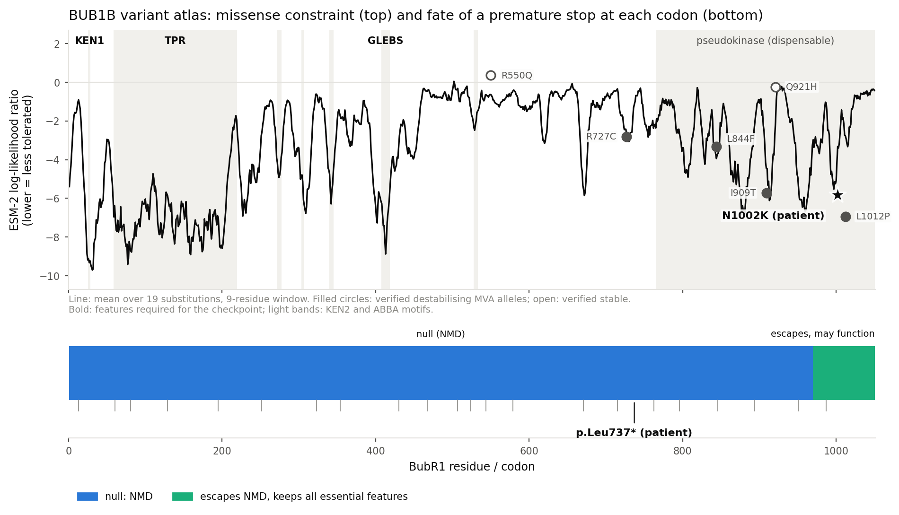

# From a child's genome to drug hypotheses for BUB1B-related MVA

**Track 2 report, Rare Disease, Real Kid: MVA Hackathon 2026**
Santiago Marin Martinez (HF / GitHub: smarin00)
Code and all results: <https://github.com/smarin00/mva-hackathon-2026>

---

## Summary

This child's mosaic variegated aneuploidy (MVA) is explained by two BUB1B
alleles: a stop-gain, p.Leu737\*, and a missense, p.Asn1002Lys (identified in
Track 1, rank points 100/100). We characterise the mechanism of each allele
and derive repurposing candidates from it.

**Mechanism.** p.Leu737\* lies 747 nt upstream of the last exon-exon junction
and is predicted to be degraded by nonsense-mediated decay: a null allele. All
of the child's BubR1 protein therefore comes from p.Asn1002Lys. Three
independent lines of evidence (a protein language model calibrated against six
experimentally characterised MVA alleles, the AlphaFold structure, and the
published biology of this domain) indicate that p.Asn1002Lys **destabilises
BubR1** rather than inactivating it; SpliceAI excludes a splicing mechanism.
The disease is therefore a **loss of function through reduced protein
quantity**, in the spindle assembly checkpoint (SAC). Published dose-response
data put the threshold for faithful chromosome segregation at roughly 13% of
normal BubR1, so a **two-fold rise in the level of the protein the child
already makes may be enough**.

**Candidates.** Three approved medicines act on routes to more, or more
stable, BubR1: **niacin** (NAD⁺ → SIRT2 → deacetylation of BubR1 K668, which
raises BubR1 levels and extended lifespan in BubR1-hypomorphic mice),
**arimoclomol** (amplifies the chaperone response for misfolding-prone
proteins; FDA-approved from age 2), and **dasatinib + quercetin** (clears
senescent cells, which delayed ageing phenotypes in BubR1 progeroid mice). An
automated, direction-aware screen of Open Targets also yields a **do-no-harm
list**: 10 HSP90 inhibitors, 18 Aurora B inhibitors, 2 MPS1 inhibitors and 3
NAMPT inhibitors that would act against this child's biology, several of them
oncology drugs relevant to a cancer-predisposed child.

**Resource.** A **BUB1B variant atlas** classifies all 19,950 possible
missense changes and all 1,050 possible premature stops by predicted mechanism
and therapy direction. Without seeing any annotation, it recovers the
experimentally defined functional map of BubR1. In ClinVar, it places only 1
of 33 benign variants in its damaging bin (base rate 43%; p ≈ 2 × 10⁻⁷), and it
shows that ClinVar still lists three experimentally verified destabilising MVA
alleles, and this child's own allele, as variants of uncertain significance.

All findings are hypotheses for experimental follow-up. A validation plan in
patient-derived cells, with go/no-go criteria, is given in Section 5.

---

## For families: what this report says, in plain words

Every cell needs a quality-control step when it divides, to make sure each new
cell gets exactly one copy of every chromosome. A protein called BubR1 is
central to that step. In MVA caused by changes in the *BUB1B* gene, some cells
end up with too many or too few chromosomes, which causes the condition's
features and raises the risk of some childhood cancers.

Everyone has two copies of *BUB1B*. In this child, one copy carries a change
that stops the cell from making any protein from it at all. The other copy
makes BubR1 that most likely works, but falls apart faster than it should, so
there is too little of it. Laboratory studies of other MVA families showed
that when this kind of unstable BubR1 is brought back to normal amounts, the
quality-control step works again, and that cells need only a fraction of the
normal amount to divide correctly.

That points to a strategy: not replacing the protein, but helping the cell
keep more of the protein it already makes. We looked for existing, approved
medicines that act on the cell's protein-protection systems. We found three
worth testing in the laboratory, and a list of medicines that would push in
the wrong direction, which may be useful to the child's doctors now.

None of this has been tested in this child's cells yet, and it is not a
treatment recommendation. It is a set of specific, testable ideas, with the
experiments that would show whether they are right.

---

## 1. Case and genotype

| Allele | GRCh38 | cDNA | Protein | Consequence |
|---|---|---|---|---|
| 1 | chr15:40209701 T>G | c.2210T>G | p.Leu737\* | stop-gain, exon 17 of 23 |
| 2 | chr15:40220612 T>G | c.3006T>G | p.Asn1002Lys | missense, pseudokinase domain |

Transcript ENST00000287598 (MANE Select), 1,050 amino acids (UniProt O60566).

Both variants were called from the provided VCF and independently from raw
reads by DeepVariant, and Exomiser ranked BUB1B first under a recessive model
(Track 1). **Phase is unresolved**: the variants are 10.9 kb apart, beyond
short-read pairs, and read-backed phasing found no shared phase block. Being
in trans is required for the diagnosis (in cis, the other copy would be wild
type). The evidence for trans is phenotypic: MVA with constitutional
aneuploidy arises from biallelic BUB1B loss, and every reported MVA1 patient
carries one truncating and one missense allele [1]. Parental testing or
long-read sequencing would settle it.

## 2. Mechanism

### 2.1 p.Leu737\* is a null allele

NMD geometry from the Ensembl transcript (`bin/nmd_check.py`): the premature
stop lies in exon 17 of 23, **747 nt upstream of the last exon-exon
junction**, about 15 times the 50-nt threshold beyond which transcripts are
degraded. Consistent with this, truncating MVA alleles are not detectable as
protein in patient cells, and their transcripts are reduced or absent [2].

This matters because the truncated protein would not by itself be useless.
The C-terminal kinase domain of BubR1 is a pseudokinase, catalytically
inactive and dispensable for checkpoint function: a truncation at residue 731
fully rescues checkpoint signalling and chromosome alignment [3]. A product
ending at residue 736 would retain every checkpoint-essential feature (KEN1,
the TPR domain, the GLEBS Bub3-binding motif). It is NMD, not the loss of
sequence, that makes this allele null.

SpliceAI (±4,999 nt) predicts no splice effect (all delta scores ≤ 0.03), so
exon skipping does not rescue it.

**All of this child's BubR1 comes from the p.Asn1002Lys allele.**

### 2.2 p.Asn1002Lys most likely destabilises BubR1

**Prior from the literature.** The reported MVA missense alleles in the
pseudokinase domain act on protein *quantity*, not activity. I909T, L1012P and
R727C turn over about two-fold faster, depend on HSP90, are cleared by the
proteasome, and are present at 2–6-fold lower levels in patient cells; raising
I909T or L1012P back to normal levels fully restores checkpoint function [2].
p.Asn1002Lys lies in the same domain, ten residues from L1012P.

**Line 1: protein language model, calibrated.** ESM-2 (650M) masked-marginal
scores are uninterpretable without a scale, so we score them against six MVA
alleles whose stability was measured experimentally [2]:

| Variant | Experimental class | ESM-2 log-likelihood ratio | Percentile in domain |
|---|---|---|---|
| L1012P | destabilising | −6.94 | 12.8 |
| **N1002K** | **patient** | **−5.81** | **18.2** |
| I909T | destabilising | −5.71 | 18.8 |
| L844F | destabilising | −3.33 | 34.8 |
| R727C | destabilising | −2.80 | 40.4 |
| Q921H | stable | −0.24 | 78.7 |
| R550Q | stable | +0.37 | 87.3 |

The model separates the two classes completely, and the patient allele falls
between L1012P and I909T, the two alleles for which HSP90 dependence and
rescue by overexpression were shown directly. With n = 6, a perfect 4-versus-2
split occurs by chance with p ≈ 0.07: suggestive, not conclusive. ESM-2
scores evolutionary constraint, not folding; it is a stability proxy here
because the pseudokinase domain has no catalytic role.

**Line 2: structure.** In the AlphaFold model (AF-O60566-F1), N1002 is
confidently placed (pLDDT 91) and partially buried (relative solvent
accessibility 0.16) in an aromatic pocket formed by Trp973, Phe977, Trp978 and
Val998. Its side-chain amide makes three hydrogen bonds to backbone atoms of
Trp978 (N and O) and Val998 (O), bridging two segments of the fold. Lysine is
longer and positively charged: it cannot reproduce this donor-acceptor bridge,
and it places a charge in an aromatic pocket. We also report a negative
result: burial alone does not separate the calibration classes (the stable
control Q921H is buried too), so the structure supplies a physical mechanism,
not independent discrimination.

**Line 3: SpliceAI** excludes the alternative that the variant acts on
splicing (all delta scores ≤ 0.02 in BUB1B and in the overlapping PAK6
read-through annotation).

**Conclusion.** No single line is proof; together they make a stability defect
the most likely mechanism. The decisive experiment is a cycloheximide chase in
patient cells (Section 5).

### 2.3 Disease mechanism: loss of function by dosage

| | |
|---|---|
| Loss or gain of function | **Loss of function**: one null allele plus one hypomorphic (destabilised) allele |
| Pathway disrupted | **Spindle assembly checkpoint.** BubR1, with Bub3, Mad2 and Cdc20, forms the mitotic checkpoint complex, which inhibits the APC/C-Cdc20 ubiquitin ligase until every kinetochore is attached; BubR1 also stabilises kinetochore-microtubule attachments |
| Downstream consequence | Premature anaphase and missegregation, giving **mosaic aneuploidy** across tissues; cancer predisposition (embryonal rhabdomyosarcoma, Wilms tumour, leukaemia reported in MVA [1]); in BubR1-hypomorphic mice, early senescence and progeroid features [4, 5] |

**The quantitative key.** Segregation is extremely sensitive to BubR1 dosage:
reducing BubR1 to about 6% of normal causes missegregation in most cells,
while about 13% has virtually no effect [2]. Biallelic null alleles have never
been reported and are presumably lethal [1]. MVA1 therefore sits in a narrow
band of residual BubR1, and **a roughly two-fold increase of the existing,
functional protein may cross the threshold**. This defines the therapeutic
goal: raise the steady-state level of a functional but unstable protein. There
is no enzyme activity to restore.

### 2.4 Aneuploidy from sequencing depth: reported as unconfirmed

We profiled chromosome-level depth and B-allele frequency from the reads.
Chromosomes 16, 17 and 19 show 1.3–1.9% elevated depth, but chromosome GC
content predicts the depth ratio under all three GC-correction models tested
(Spearman ρ 0.48–0.69), and B-allele frequency shows no corresponding signal.
These shifts are therefore flagged as **unconfirmed**, consistent with, but
not proven to be, residual GC or replication-timing bias
(`findings/aneuploidy/`). This is the expected result for MVA: aneuploidy is
random across cells and averages out in bulk DNA. The cytogenetic diagnosis
rests on the clinical karyotype.

## 3. From mechanism to candidates

### 3.1 Approach

Candidate identification combined an **automated screen** and **mechanism-led
curation**:

1. **Direction-aware drug screen** (`bin/opentargets_candidates.py`). An
   11-gene panel around BubR1 dosage, each gene annotated with the direction
   that would help (for example SIRT2 up, HSF1 up, HSP90 *not inhibited*) and
   the literature behind it, was crossed with every drug and clinical
   candidate in Open Targets (API 26.9.0, data 26.09) and its ChEMBL action
   type. Each drug was classified automatically as *candidate* (acts in the
   desired direction), *do-no-harm* (acts against it) or *review*.
2. **Named-drug lookup** for agents that act on a pathway rather than through
   one annotated target.
3. **Curation** of every candidate against the mechanism, and against
   pediatric safety and approval status from primary regulatory sources.

The screen found **no drug acting directly on BUB1B, SIRT2 or HSF1**, so the
leads below come from pathway-level reasoning. It also exposed database
limitations that curation corrected: arimoclomol is still listed at phase 3
despite FDA approval, and several dietary supplements carry "approval" flags.

### 3.2 Candidates

| | Candidate | Route to more BubR1 | Evidence for BubR1 specifically | Approval | Main risks |
|---|---|---|---|---|---|
| 1 | **Niacin** (nicotinic acid) | NAD⁺ → SIRT2 → BubR1 K668 deacetylation → less degradation | **Direct, in vivo** [5] | FDA-approved (dyslipidaemia) | Flushing; hepatotoxicity at high dose; no pediatric NAD⁺ data |
| 2 | **Arimoclomol** | Amplifies the HSF1 heat-shock response → chaperone support for a misfolding-prone protein | Mechanism-class extrapolation | FDA-approved Sept 2024 (Niemann-Pick C), age ≥ 2; EU: negative CHMP opinion July 2026 | Hypersensitivity; no BubR1 data |
| 3 | **Dasatinib + quercetin** | Downstream: clears senescent cells | Genetic clearance in BubR1 progeroid mice [4] | Dasatinib FDA-approved, incl. pediatric Ph+ ALL | Myelosuppression, pleural effusion; treats consequences, not cause |

**1. Niacin: lead candidate.** BubR1 levels fall when NAD⁺ and SIRT2 activity
fall. SIRT2 deacetylates BubR1 at K668 (counteracting the acetyltransferase
CBP), raising BubR1 abundance in vivo; the NAD⁺ precursor NMN raised BubR1
levels in mice; and increasing SIRT2 **extended the median lifespan of
BubR1-hypomorphic mice** [5], the closest animal model of MVA's dosage loss.
p.Asn1002Lys is full-length and keeps K668, so the pathway still has its
substrate. Niacin is the approved NAD⁺ precursor of choice: at 750–1,000
mg/day it raised blood NAD⁺ up to eight-fold in adults with mitochondrial
myopathy [6]. It enters NAD⁺ synthesis through NAPRT, bypassing NAMPT, and
unlike nicotinamide it does not feed back to inhibit sirtuins. Nicotinamide
riboside, a dietary supplement rather than an approved medicine, is a
better-tolerated alternative with pediatric precedent: 25 mg/kg/day for four
months in 24 patients with ataxia-telangiectasia, 17 of them under 18 [7].
*Gap:* SIRT2-mediated stabilisation was shown for wild-type BubR1; whether it
rescues a destabilised mutant is the first thing to test.

**2. Arimoclomol.** It amplifies HSF1-driven induction of HSP70-family
chaperones under stress, supporting proteins prone to misfolding. The
neighbouring allele L1012P is a verified chaperone-dependent client [2]. HSF1
also induces HSP90, which should help an HSP90 client, but that is a
prediction. Arimoclomol is approved for children from age 2 in the US [8],
which shortens any path to a trial; it is not approved in the EU [9].
Aneuploid cells experience proteotoxic stress, so improved chaperone capacity
might help the aneuploid cells MVA keeps producing as well; this is a further
hypothesis, not evidence.

**3. Dasatinib + quercetin.** Clearing p16Ink4a-positive senescent cells in
BubR1 progeroid mice delayed ageing phenotypes in eye, muscle and fat, even
when started late [4]. That study used genetic clearance; dasatinib +
quercetin is the senolytic regimen studied in humans. This treats
consequences rather than cause and carries real toxicity, so it ranks last.
Fisetin is a better-tolerated, non-approved alternative.

**Rejected at curation.** PRI-724 appears as a CBP inhibitor, which is the
desired direction, but it blocks the CBP–β-catenin interaction, not CBP's
acetyltransferase activity, so it cannot act on BubR1 K668. Navitoclax and
obatoclax (BCL-xL inhibitors) cause thrombocytopenia and are not justified in
a child. High-dose nicotinamide inhibits sirtuins. Proteasome inhibitors
rescued mutant BubR1 in vitro [2] but are too toxic systemically; they remain
a proof of mechanism.

### 3.3 Do-no-harm list

This is the output most relevant to current care: "care today means managing
symptoms and fighting cancer cells", and several agents below are in oncology
use or trials.

| Class | In Open Targets | Why it is expected to harm | Examples |
|---|---|---|---|
| HSP90 inhibitors | 10 | Mutant BubR1 is an HSP90 client; HSP90 inhibition depleted it in patient-derived cells [2] | ganetespib, tanespimycin, luminespib, onalespib |
| NAMPT inhibitors | 3 | Deplete NAD⁺, opposing candidate 1 | daporinad (trialled in childhood leukaemia), teglarinad |
| Aurora B inhibitors | 18 | Impair error correction in an already weakened checkpoint | barasertib, tozasertib, danusertib |
| MPS1 (TTK) inhibitors | 2 | Weaken the spindle assembly checkpoint directly | BAY-1161909, BAY-1217389 |

## 4. A resource for other families: the BUB1B variant atlas

Every MVA1 patient reported so far carries one truncating and one missense
allele [1], so each new family faces the same two questions this report
answered for one child. The atlas (`findings/track2/atlas/`) answers them for
every possible variant.

*Top: positional constraint (ESM-2, mean over 19 substitutions, 9-residue
window), with the calibration alleles and the patient's missense. Bottom: NMD
fate of a premature stop at each codon.*

**It recovers the functional map unaided.** ESM-2 sees only the sequence, yet
it ranks KEN1 (mean −11.2, more constrained than 99% of positions), GLEBS
(−7.8) and the TPR domain (−6.9) as the most constrained regions, and the
linker at residues 450–650, which AlphaFold models as disordered (median pLDDT
34), as nearly unconstrained (−1.0). Experiment, evolution and structure
agree.

**Truncating variants.** Stops at codons 1–969 are predicted null by NMD.
Stops at **codons 970–1,050 (the last 81 codons) escape NMD and keep every
checkpoint-essential feature**, so by analogy with the functional 731X
truncation [3] they may act as mild or tolerated alleles. A truncating BUB1B
variant should not be assumed null without checking its position.

**Missense variants.** All 19,950 changes are binned by calibrated ESM-2
score and mapped to a therapy direction: stability defect where dose-raising
applies (2,190, 11%); functional-site defect where more protein may not
compensate (3,174, 16%); likely tolerated (4,001, 20%); uncertain (10,585,
53%). The large uncertain share comes from linker regions without
characterised function and from the wide gap between only six calibration
anchors. The atlas is a triage tool, not a classifier.

**Independent check against ClinVar** (`bin/clinvar_validate.py`; the six
calibration alleles excluded). ClinVar holds 1,494 BUB1B missense records, 97%
of them variants of uncertain significance (VUS) or conflicting:

| Atlas bin | Benign / likely benign (33 unique) | Protein-wide base rate |
|---|---|---|
| like destabilisers | **1 (3%)** | 43% |
| indeterminate | 13 (39%) | 37% |
| likely tolerated | **19 (58%)** | 20% |

Benign variants avoid the damaging bin (one-sided binomial p ≈ 2 × 10⁻⁷) and
are enriched in the tolerated bin (p ≈ 2 × 10⁻⁶). Some benign assertions use
in-silico evidence, so the test is not fully independent. The pathogenic side
cannot be tested: ClinVar holds a single non-calibration pathogenic missense
(Q467H, single submitter), which the atlas places in its indeterminate bin.

**What ClinVar is missing.** It lists L1012P, L844F and R727C, experimentally
verified destabilising MVA alleles [2], as VUS, and this child's p.Asn1002Lys
as a VUS. Calibrated computational evidence of this kind, together with the
published functional data, is what variant-classification guidelines can use
to move such alleles out of uncertainty. Of the 1,427 unique ClinVar VUS, the
atlas places 419 as likely tolerated and 107 in the stability-defect class,
where the strategy proposed here would apply if they occurred with a null
allele.

## 5. Proposed validation

In patient-derived cells (lymphoblastoid line or fibroblasts), with healthy
controls:

| Step | Experiment | Go / no-go |
|---|---|---|
| 1 | BubR1 protein level (western blot) | Confirms the premise if well below 50% of control |
| 2 | Cycloheximide chase | Confirms instability if p.Asn1002Lys BubR1 turns over faster than wild type |
| 3 | Niacin or NR, arimoclomol; dose series | **Go** if BubR1 rises above ~13% of control |
| 4 | Checkpoint (nocodazole arrest) and missegregation (live imaging or interphase FISH) | **Go** if missegregation falls measurably |
| 5 | HSP90 inhibitor as positive control | Tests the do-no-harm prediction: BubR1 should fall further |

A positive step 3–4 would justify a discussion with the child's clinicians;
steps 1–2 would also provide functional evidence to reclassify p.Asn1002Lys.

## 6. Scalability

- **The pipeline runs end to end with `make`**: tools, references, Track 1
  from raw reads or VCF, and every Track 2 analysis
  (`make setup gtf track2` reproduces Track 2 without patient data).
  Versions, container digests and database releases are recorded.
- **Every Track 2 method is gene-agnostic**: NMD geometry, structural
  context, calibrated language-model scoring and the direction-aware screen
  take a gene, a protein, a pathway panel and a set of characterised alleles
  as inputs. Any disorder with a handful of functionally characterised
  variants can be calibrated the same way.
- **The direction-aware screen** turns a mechanism into both a candidate list
  and a do-no-harm list in one pass, which a plain target-to-drug lookup does
  not.

## 7. Limitations

- Phase is inferred from the phenotype, not observed.
- The stability mechanism rests on three supporting lines (n = 6 calibration;
  burial not discriminative; literature prior), not on a measurement in this
  child's cells.
- The atlas's missense bins rest on six calibration alleles; 53% of missense
  changes remain uncertain, and the pathogenic side could not be validated
  against ClinVar.
- No candidate has BubR1-specific evidence in human cells. Niacin's link runs
  through wild-type BubR1 in mice; arimoclomol's is a mechanism-class
  extrapolation; senolytics act downstream.
- Pediatric dosing and safety of niacin at NAD⁺-raising doses are unknown.
- Bulk sequencing cannot measure mosaic aneuploidy at the levels expected in
  MVA.
- All drug and target annotations come from public databases at one release;
  regulatory status was checked against primary sources on 19–20 Oct 2026.

## 8. Methods, data handling and AI use

Methods and every command are in the repository (`README.md`, `Makefile`,
`docs/decisions.md`, `docs/reference_data.md`). Track 1 used Nextflow 26.04
with DeepVariant 1.10.0, Exomiser 15.1.0 (data 2602) and Ensembl VEP 116 on
GRCh38. Track 2 used Ensembl 116, UniProt O60566, AlphaFold DB, ESM-2 650M,
SpliceAI 1.3.1, ClinVar (fileDate 2026-10-04) and Open Targets 26.09.

Patient data were analysed only on a dedicated server and never entered the
repository; all data and genotype-level derived files will be deleted by
23 November 2026 (`docs/DELETION.md`).

AI assistance: Anthropic, Claude via claude.ai, consumer Pro plan (Claude
Opus 5.5); model training disabled; no outputs rated. Used for pipeline
design, code, literature search and drafting; all analyses were run and
reviewed by the author. No genome-scale data were shared (`docs/llm_usage.md`).

## References

1. Hanks S. et al. Constitutional aneuploidy and cancer predisposition caused
   by biallelic mutations in BUB1B. *Nat Genet* 36, 1159–1161 (2004).
2. Suijkerbuijk S.J.E. et al. Molecular causes for BUBR1 dysfunction in the
   human cancer predisposition syndrome mosaic variegated aneuploidy.
   *Cancer Res* 70, 4891–4900 (2010).
3. Suijkerbuijk S.J.E. et al. The vertebrate mitotic checkpoint protein BUBR1
   is an unusual pseudokinase. *Dev Cell* 22, 1321–1329 (2012).
4. Baker D.J. et al. Clearance of p16Ink4a-positive senescent cells delays
   ageing-associated disorders. *Nature* 479, 232–236 (2011).
5. North B.J. et al. SIRT2 induces the checkpoint kinase BubR1 to increase
   lifespan. *EMBO J* 33, 1438–1453 (2014).
6. Pirinen E. et al. Niacin cures systemic NAD⁺ deficiency and improves muscle
   performance in adult-onset mitochondrial myopathy. *Cell Metab* 31,
   1078–1090 (2020).
7. Nicotinamide riboside in ataxia-telangiectasia. *Mov Disord* (2021).
   doi:10.1002/mds.28788.
8. US FDA. FDA approves first treatment for Niemann-Pick disease type C
   (20 September 2024).
9. Zevra Therapeutics. Update on the EU regulatory submission for arimoclomol
   (negative CHMP opinion, 24 July 2026).
10. BubR1 TPR domain supports the mitotic checkpoint by promoting MCC
    formation and MCC-APC/C interaction. *Commun Biol* (2026).
    doi:10.1038/s42003-026-10384-9. (Domain boundaries.)
