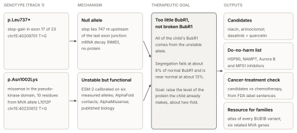
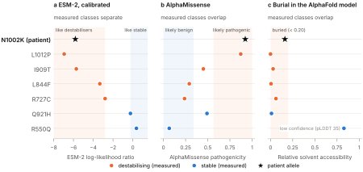
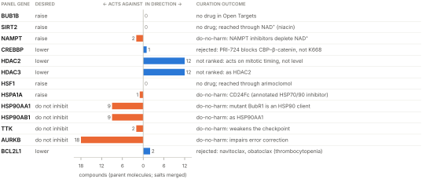
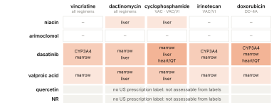
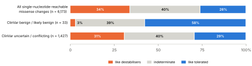
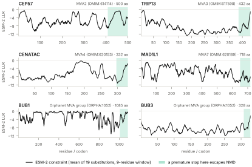

# More of the protein the child already makes: from a BUB1B genotype to drug hypotheses in mosaic variegated aneuploidy

**Track 2 report · Rare Disease, Real Kid: MVA Hackathon 2026**
Santiago Marin Martinez (Hugging Face / GitHub: smarin00) · 24 October 2026
Code, results and every number in this report: <https://github.com/smarin00/mva-hackathon-2026>

> **Summary.** This child presented with rhabdomyosarcoma. The genome explains why: two
> *BUB1B* alleles, found in Track 1 (rank points 100/100), cause mosaic variegated
> aneuploidy (MVA), a cancer-predisposing disorder. The stop-gain p.Leu737\*
> is degraded by nonsense-mediated decay (NMD), so every BubR1 molecule the child has
> comes from the missense allele p.Asn1002Lys. Four lines of evidence indicate that this
> allele makes a working but unstable protein: a protein language model calibrated
> against six experimentally measured MVA alleles, the AlphaFold structure, an
> independent predictor (AlphaMissense) and the published biology of the domain.
> SpliceAI excludes a splicing effect. **The child already makes a working protein;
> there just isn't enough of it.** Because chromosome segregation fails at about 6% of
> normal BubR1 and is near normal at about 13%, raising the existing protein about
> two-fold is a realistic therapeutic goal.
>
> A direction-aware screen of Open Targets, followed by documented curation, gives
> three approved-drug hypotheses. **Niacin** (NAD⁺ → SIRT2 → BubR1 K668) is the lead,
> followed by **arimoclomol** (chaperone induction; FDA-approved from age 2) and
> **dasatinib + quercetin** (senescent-cell clearance, downstream). The same screen
> gives a **do-no-harm list** of 31 compounds, many of them oncology drugs, that would
> push the wrong way. A check against current FDA labels shows that niacin and
> arimoclomol could continue alongside rhabdomyosarcoma chemotherapy, which children
> with this syndrome are reported to tolerate poorly, whereas dasatinib should not.
>
> For other families, a **variant atlas** maps all 19,950 possible BubR1 missense
> changes and all 1,050 possible premature stops to a mechanism and a therapy
> direction. Without any annotation it recovers the experimentally defined map of the
> protein. It agrees with ClinVar benign variants it never saw (1 of 33 in its damaging
> bin, against 34% expected; p = 2 × 10⁻⁵). The pipeline then extends the atlas to the six
> other genes linked to MVA. Everything runs from one case file with `make all`, and a
> clean rerun reproduced every result. All findings are hypotheses; a validation plan
> in patient cells, with go/no-go criteria, is given in Section 5.

**Figure 1. From genotype to drug hypotheses.** The truncating allele makes no
protein, so the phenotype rests on the missense allele. Evidence that this allele is
destabilised, not inactive, turns the problem into one of protein quantity. That
defines the therapeutic goal, which drives the drug screen, the do-no-harm list, the
cancer-treatment check and the resource for other families.

## For families: what this report says, in plain words

Every cell needs a quality-control step when it divides, to make sure each new cell
gets exactly one copy of every chromosome. A protein called BubR1 is central to that
step. In MVA caused by changes in the *BUB1B* gene, some cells end up with too many or
too few chromosomes, which causes the condition's features and raises the risk of
some childhood cancers.

Everyone has two copies of *BUB1B*. In this child, one copy carries a change that
stops the cell from making any protein from it. The other copy makes BubR1 that most
likely works but falls apart faster than it should, so there is too little of it.
Laboratory studies of other MVA families showed that when this kind of unstable BubR1
is brought back to normal amounts, the quality-control step works again, and that cells
need only a fraction of the normal amount to divide correctly.

That points to a strategy: not replacing the protein, but helping the cell keep more
of the protein it already makes. We looked for existing, approved medicines that act on
the cell's protein-protection systems. We found three worth testing in the laboratory,
and a list of medicines that would push in the wrong direction, which may be useful to
the child's doctors now. Because the child has already had a cancer, we also checked
that these medicines would not clash with cancer treatment. None of this has been tested in this child's cells yet, and it
is not a treatment recommendation. It is a set of specific, testable ideas, together with
the experiments that would show whether they are right.

## 1. Case and genotype

The child presented with rhabdomyosarcoma (HPO HP:0002859), the oncological event that
triggered the genetic investigation. Track 1 found two *BUB1B* alleles:

| Allele | GRCh38 | cDNA | Protein | Consequence |
|---|---|---|---|---|
| 1 | chr15:40209701 T>G | c.2210T>G | p.Leu737\* | stop-gain, exon 17 of 23 |
| 2 | chr15:40220612 T>G | c.3006T>G | p.Asn1002Lys | missense, pseudokinase domain |

Transcript ENST00000287598 (MANE Select); BubR1, 1,050 amino acids (UniProt O60566).

Both variants were called in the provided VCF and again from the raw reads by
DeepVariant, and Exomiser ranked *BUB1B* first (Track 1). **Phase is unresolved.** The
variants are 10.9 kb apart, beyond the reach of short-read pairs, and read-backed
phasing found no shared phase block. The diagnosis needs them in trans (in cis, the
other copy would be wild type). The evidence for trans is phenotypic: MVA with
constitutional aneuploidy arises from biallelic *BUB1B* loss, and MVA1 patients
typically carry one truncating and one missense allele [1]. Parental testing or
long-read sequencing would settle it.

## 2. Mechanism

### 2.1 p.Leu737\* is a null allele

From the Ensembl transcript structure (`bin/nmd_check.py`), the premature stop lies in
exon 17 of 23, **747 nt upstream of the last exon-exon junction**. That is about 15
times the 50-nt boundary beyond which transcripts are degraded by NMD [2, 3].
Consistent with this, truncating MVA alleles are not detectable as protein in patient
cells, and their transcripts are reduced or absent [4]. SpliceAI [5] predicts no splice
effect (all delta scores ≤ 0.03), so exon skipping does not rescue the allele.

The point matters because the truncated protein would not be useless if it were made.
BubR1's C-terminal kinase domain is a catalytically inactive pseudokinase that the
checkpoint does not need: a truncation at residue 731 fully rescues checkpoint
signalling and chromosome alignment [6]. A product ending at residue 736 would keep
every checkpoint-essential feature (KEN1, the TPR domain, the GLEBS motif that binds
Bub3) [7]. NMD, not the loss of sequence, makes this allele null. **All of the child's
BubR1 therefore comes from the p.Asn1002Lys allele.**

### 2.2 p.Asn1002Lys most likely destabilises BubR1

**Prior from the literature.** The characterised MVA missense alleles in and against
the pseudokinase domain act on protein *quantity*, not activity. I909T, L1012P and
R727C turn over about two-fold faster, depend on HSP90, are cleared by the proteasome
and are present at 2–6-fold lower levels in patient cells. Raising I909T or L1012P back
to normal levels fully restores checkpoint function [4]. p.Asn1002Lys lies in the same
domain, ten residues from L1012P.

**Figure 2. Three predictors tested against six alleles with measured stability [4].**
(a) ESM-2 separates the destabilising from the stable alleles completely, and the
patient allele falls between the two best-characterised destabilisers. Shading marks
the calibrated bins used by the atlas. (b) AlphaMissense calls the patient allele
likely pathogenic but does not separate the measured classes. (c) Burial does not
separate them either. Sources: `findings/track2/esm_scores.tsv`,
`alphamissense/summary.txt`, `structure_context.tsv`.

**Line 1: a protein language model, calibrated.** ESM-2 (650M) masked-marginal scores
[8, 9] have no scale on their own, so we read them against six MVA alleles whose
stability was measured experimentally [4] (`bin/esm_variant_score.py`):

| Variant | Measured class | ESM-2 log-likelihood ratio | Percentile in pseudokinase domain |
|---|---|---|---|
| L1012P | destabilising | −6.94 | 12.8 |
| **N1002K** | **patient** | **−5.81** | **18.2** |
| I909T | destabilising | −5.71 | 18.8 |
| L844F | destabilising | −3.33 | 34.8 |
| R727C | destabilising | −2.80 | 40.4 |
| Q921H | stable | −0.24 | 78.7 |
| R550Q | stable | +0.37 | 87.3 |

The model separates the two classes completely, and the patient allele falls between
L1012P and I909T, the two alleles for which HSP90 dependence and rescue by
overexpression were shown directly. With six alleles, a perfect 4-versus-2 split
arises by chance with p = 1/15 ≈ 0.07: suggestive, not conclusive. ESM-2 scores
evolutionary constraint, not folding. It serves as a stability proxy here because the
pseudokinase domain has no catalytic role.

**Line 2: structure.** In the AlphaFold model (AF-O60566-F1) [10], N1002 is confidently
placed (pLDDT 91) and buried (relative solvent accessibility 0.16) in a pocket lined by
Trp973, Phe977, Trp978 and Val998. Its side-chain amide lies within hydrogen-bonding
distance (≤ 3.5 Å) of three backbone atoms, Trp978 N and O and Val998 O, bridging two
segments of the fold. Lysine is longer and positively charged: it cannot reproduce
this donor-acceptor bridge, and it puts a charge into a pocket lined by aromatic side
chains. We also report a negative result: burial alone does not separate the measured
classes, because the stable control Q921H is buried too (Figure 2c). The structure
supplies a physical mechanism, not independent discrimination.

**Line 3: an independent predictor.** AlphaMissense [11], trained on primate population
frequency and structural context rather than on these alleles, scores p.Asn1002Lys 0.92
(*likely pathogenic*). The two predictors therefore agree on the patient allele. Unlike
ESM-2, however, AlphaMissense does **not** reproduce the measured classes. It calls two
verified destabilisers likely benign (R727C 0.24, L844F 0.29), leaves a third ambiguous
(I909T 0.45) and scores the stable control Q921H (0.49) above three of the four. Across
all 6,173 missense changes it scores, the two predictors correlate moderately (Spearman
|ρ| = 0.65; 0.80 in the TPR domain). Our reading is that a general pathogenicity score,
tuned to clearly damaging variants, underrates mild hypomorphic stability alleles,
which is the class MVA1 missense alleles belong to. That is why ESM-2 calibrated on
measured stability is the primary line here; with six alleles this remains indicative.

**Line 4: splicing excluded.** SpliceAI predicts no splice effect (all delta scores
≤ 0.02, in *BUB1B* and in the overlapping *PAK6* read-through annotation).

**Conclusion.** No single line is proof; together they make a stability defect the
most likely mechanism. The decisive experiment is a cycloheximide chase in patient
cells (Section 5).

### 2.3 Disease mechanism and therapeutic goal

| | |
|---|---|
| Loss or gain of function | **Loss of function**: one null allele plus one hypomorphic (destabilised) allele |
| Pathway disrupted | **Spindle assembly checkpoint.** BubR1, with Bub3, Mad2 and Cdc20, forms the mitotic checkpoint complex, which holds back the APC/C–Cdc20 ubiquitin ligase until every kinetochore is attached; BubR1 also stabilises kinetochore-microtubule attachments |
| Downstream consequence | Premature anaphase and chromosome missegregation, giving **mosaic aneuploidy** across tissues; cancer predisposition (rhabdomyosarcoma, this child's presenting tumour; Wilms tumour; leukaemia [1, 12]); in BubR1-hypomorphic mice, early senescence and progeroid features [13, 14] |

**The quantitative key.** Segregation is very sensitive to the BubR1 dose: about 6% of
normal causes missegregation in most cells, while about 13% has virtually no effect
[4]. Biallelic null alleles have not been reported and are presumably lethal [1]. MVA1
therefore sits in a narrow band of residual BubR1, and **a roughly two-fold increase of
the existing, functional protein may be enough to cross the threshold.** The goal is to
raise the steady-state level of a working but unstable protein; there is no enzyme
activity to restore.

Bulk sequencing depth was also profiled for aneuploidy. Chromosomes 16, 17 and 19
show 1.3–2.3% higher depth, depending on the GC model, but chromosome GC content predicts the shift under all
three GC-correction models tested (Spearman ρ 0.48–0.69), and the B-allele frequency
shows no matching signal. These shifts are reported as unconfirmed
(`findings/aneuploidy/`). This is the expected result for MVA: aneuploidy differs from
cell to cell and averages out in bulk DNA.

## 3. From mechanism to candidates

### 3.1 A direction-aware screen, then curation

Candidate identification combined an automated screen with documented curation:

1. **Direction-aware screen** (`bin/opentargets_candidates.py`). A 13-gene panel around
   BubR1 dosage (`config/genes/bub1b.yaml`) records, for each gene, the direction that
   would help the child and the paper behind it: SIRT2 *up*, HSF1 *up*, HSP90 *do not
   inhibit*, and so on. The panel was crossed with every drug and clinical candidate in
   Open Targets (API 26.9.0, data 26.09) using the ChEMBL action type, and each
   drug-target pair was classified automatically: *in the desired direction*, *against
   it* (do-no-harm) or *review*.
2. **Named-drug lookup** for agents that act on a pathway rather than through one
   annotated target (niacin, nicotinamide riboside, arimoclomol, valproate, senolytics).
3. **Curation** of every result against the mechanism, and against pediatric safety and
   approval status taken from primary regulatory sources.

The screen is informative mainly for what it rules out (Figure 3). **No drug acts
directly on BUB1B, SIRT2 or HSF1**, so the leads below enter through named-drug lookup
and the literature. Its 15 compounds in the desired direction were all curated out (12
HDAC inhibitors, two BCL-xL inhibitors and the CBP inhibitor PRI-724; Section 3.3).
Its 31 compounds acting against the child's biology form the do-no-harm list
(Section 3.4). The screen also exposed database errors that curation corrected:
arimoclomol is still listed at phase 3 despite FDA approval, and several dietary
supplements (nicotinamide riboside, quercetin, fisetin) carry "approved" flags.

**Figure 3. The screen, gene by gene.** Compounds in Open Targets acting on each panel
gene, split by whether they act in the direction that would help (right) or against it
(left), and what curation concluded. Salt forms are merged into one compound. Source:
`findings/track2/opentargets/ot_target_drugs.tsv`.

### 3.2 Candidates

| | Candidate | Route to more BubR1 | Evidence for BubR1 specifically | Approval | Main risks |
|---|---|---|---|---|---|
| 1 | **Niacin** (nicotinic acid) | NAD⁺ → SIRT2 → deacetylation of BubR1 K668 → less degradation | **Direct, in vivo** [14] | FDA-approved (dyslipidaemia) | Flushing; liver toxicity at high dose; no pediatric NAD⁺ data |
| 2 | **Arimoclomol** | Amplifies the HSF1 heat-shock response → chaperone support for a misfolding-prone protein | Mechanism-class extrapolation | FDA 2024 (Niemann-Pick C, with miglustat), age ≥ 2 [15]; not EU-approved [16] | Hypersensitivity; no BubR1 data |
| 3 | **Dasatinib + quercetin** | Downstream: clears senescent cells | Genetic clearance in BubR1 progeroid mice [13] | Dasatinib FDA-approved, incl. pediatric Ph+ ALL | Marrow suppression, pleural effusion; treats consequences, not cause |

**1. Niacin: the lead.** BubR1 levels fall when NAD⁺ and SIRT2 activity fall. SIRT2
deacetylates BubR1 at K668, counteracting the acetyltransferase CBP, and raises BubR1
abundance in vivo. The NAD⁺ precursor NMN raised BubR1 levels in mice, and more SIRT2
**extended the median lifespan of BubR1-hypomorphic mice** [14], the closest animal model
of the dosage loss in MVA. p.Asn1002Lys is full length and keeps K668, so the pathway
still has its substrate. Niacin is the approved NAD⁺ precursor of choice: at 750–1,000
mg/day it raised blood NAD⁺ up to eight-fold in adults with mitochondrial myopathy [17].
It enters NAD⁺ synthesis through NAPRT, bypassing NAMPT, and unlike nicotinamide it does
not feed back to inhibit sirtuins. Nicotinamide riboside, a dietary supplement rather
than an approved medicine, is a better-tolerated alternative with pediatric precedent:
25 mg/kg/day for four months in 24 patients with ataxia-telangiectasia, 17 of them under
18 [18]. *Gap:* SIRT2-mediated stabilisation was shown for wild-type BubR1; whether it
rescues a destabilised mutant is the first thing to test. *Caveat:* SIRT2 can also
deacetylate a second site, K250, whose acetylation protects BubR1 in mitosis [19]. The
in vivo net effect of more SIRT2 was more BubR1 [14], but validation should measure
BubR1 through mitosis as well as at steady state.

**2. Arimoclomol.** It amplifies HSF1-driven induction of HSP70-family chaperones under
stress, supporting proteins that are prone to misfold. The neighbouring allele L1012P is
a verified chaperone-dependent client [4]. HSF1 also induces HSP90, which should help an
HSP90 client, but that is a prediction. Arimoclomol is approved in the US for children
from age 2 [15], which shortens any path to a trial; the EU's CHMP gave a negative
opinion in July 2026 [16].

**3. Dasatinib + quercetin.** Clearing p16Ink4a-positive senescent cells in BubR1
progeroid mice delayed ageing phenotypes in eye, muscle and fat, even when started late
[13]. That study used genetic clearance; dasatinib + quercetin is the senolytic regimen
studied in humans. This treats consequences rather than cause and carries real
toxicity, so it ranks last.

### 3.3 Considered and not ranked: HDAC inhibitors

HDAC2 and HDAC3 remove a protective acetylation at BubR1 K250 at the end of mitosis
[20], which is why the screen returned 12 HDAC inhibitors in the desired direction. Six
are listed as approved in Open Targets, including givinostat, which the FDA approved in 2024 for
Duchenne muscular dystrophy from age 6 [21]; valproate, a weak class I inhibitor with
long pediatric use, entered through named-drug lookup. We read the three primary papers
in full, and they argue against ranking any of these. K250 acetylation exists only in
mitosis and sets *when* BubR1 is destroyed, not how much there is: an
acetylation-deficient allele left overall BubR1 levels unchanged [22]. The direct
effect of keeping K250 acetylated is a longer metaphase. In a checkpoint that is too
short that might help, but HDAC inhibitors also use mitotic arrest to kill dividing
cells [19, 20], and the oncology HDAC inhibitors cause thrombocytopenia. The route
enters the validation plan as an exploratory arm (mitotic timing and missegregation in
patient cells), not as a candidate.

**Rejected at curation.** PRI-724 is listed as a CBP inhibitor, the desired direction,
but it blocks the CBP–β-catenin interaction rather than CBP's acetyltransferase
activity, so it cannot act on BubR1 K668. Navitoclax and obatoclax (BCL-xL inhibitors)
cause thrombocytopenia and are not justified in a child. High-dose nicotinamide
inhibits sirtuins. Proteasome inhibitors rescued mutant BubR1 in vitro [4] but are too
toxic systemically; they remain a proof of mechanism.

### 3.4 Do-no-harm list

This may be the output most useful to the child's doctors today: the child has had
rhabdomyosarcoma, and several of these agents are in oncology use or trials.

| Class | Compounds | Why it is expected to harm | Examples |
|---|---|---|---|
| HSP90 inhibitors | 9 | Mutant BubR1 is an HSP90 client; HSP90 inhibition depleted it in patient-derived cells [4] | ganetespib, tanespimycin, luminespib, onalespib |
| NAMPT inhibitors | 2 | Deplete NAD⁺, opposing candidate 1 | daporinad (trialled in childhood leukaemia), teglarinad |
| Aurora B inhibitors | 18 | Impair error correction and checkpoint signalling in an already weakened checkpoint (contested, see below) | barasertib, tozasertib, danusertib |
| MPS1 (TTK) inhibitors | 2 | Weaken the spindle assembly checkpoint directly | BAY-1161909, BAY-1217389 |

The HSP90 count includes CD24Fc, a fusion protein that ChEMBL annotates as an
HSP70/HSP90 inhibitor. Only the HSP90 entry rests on a direct measurement in MVA
patient cells; the others follow from the mechanism.

**The Aurora B entry is contested.** BubR1 recruits the phosphatase PP2A-B56 to
kinetochores, where it counterbalances Aurora B, and inhibiting Aurora B restored
chromosome congression in cells whose BubR1 cannot recruit PP2A-B56 [23]. Congression is
not accurate segregation, however: Aurora B also corrects wrong attachments and signals
to the checkpoint, and the clinical inhibitors are dosed to stop cancer cells from
dividing. We keep the class on the list at oncology doses and test low-dose inhibition
as an open question in patient cells (Section 5, step 7).

### 3.5 Compatibility with cancer treatment

This child presented with rhabdomyosarcoma, and MVA1 also predisposes to Wilms tumour
and leukaemia [1, 12]. A medicine the child might take for years has to be compatible
with rhabdomyosarcoma treatment, now or at relapse, and with the treatment of a later
cancer. Children with this syndrome are also reported to tolerate chemotherapy poorly.
A boy with premature chromatid separation/MVA, the form linked to *BUB1B*, and bilateral
Wilms tumours had a severe reaction to dactinomycin monotherapy and reached long-term
remission only through bilateral nephrectomy and dialysis [24]. A child with
rhabdomyosarcoma and the same syndrome was treated successfully with reduced-intensity
chemotherapy [25]. A candidate that adds toxicity to chemotherapy is therefore a
practical risk for this child, not a theoretical one.

We checked each candidate against the standard regimens, VAC and VAC/VI for rhabdomyosarcoma [26, 27] and EE-4A
and DD-4A for Wilms tumour [28], using the current US prescribing information (FDA
labels via openFDA [29]; `make oncology`). Three checks are run for each pair: one label
names the other drug; one drug inhibits or induces CYP3A4 while the other is a CYP3A4
substrate; or both labels warn of the same organ toxicity. Every flag carries the label
sentences it rests on (`findings/track2/oncology/compatibility.tsv`).

**Figure 4. Candidates against the chemotherapy for rhabdomyosarcoma and Wilms tumour.** Each cell
lists the checks that flagged the pair; shading darkens with the number of flags. Label
versions and dates: `findings/track2/oncology/labels.tsv`.

The check separates the candidates. Niacin's only flags are liver warnings shared with
dactinomycin and cyclophosphamide (both carry hepatic veno-occlusive disease), which
liver-enzyme monitoring addresses. Because dactinomycin is also the drug reported to have
caused a severe reaction in MVA [24], a cautious option is to pause niacin during
dactinomycin-containing cycles. Arimoclomol raises no flag; its label states that it
neither inhibits nor induces CYP3A4/5. Dasatinib inhibits CYP3A4, which clears
vincristine, irinotecan and doxorubicin, and it overlaps with every regimen drug on
marrow suppression. Valproate overlaps on marrow and liver, a further reason not to rank
it. So the two candidates that act on the BubR1 dose, niacin and arimoclomol, could
continue alongside cancer treatment, while dasatinib, which treats consequences, should
be stopped before it; its marrow overlap matters more in a syndrome where chemotherapy
is already poorly tolerated. The flags are prompts for clinical review, not verdicts, and the
absence of a flag is not proof of safety. No leukaemia regimen was modelled, because the
leukaemia subtype in MVA is not specified.

## 4. A resource for other families

### 4.1 The BUB1B variant atlas

MVA1 patients typically carry one truncating and one missense allele [1], so each
new family faces the two questions this report answered for one child. The atlas
(`bin/variant_atlas.py`, `findings/track2/atlas/`) answers them for every possible
variant.

**It recovers the functional map unaided.** ESM-2 sees only the sequence, yet the most
constrained features are exactly the checkpoint-essential ones [7]: KEN1 (mean −11.2, more
constrained than 98.6% of positions), KEN2 (−9.0), the GLEBS motif (−7.8) and the TPR
domain (−6.9). The linker at residues 450–650, which AlphaFold models as disordered
(median pLDDT 34), is nearly unconstrained (−1.0). Experiment, evolution and structure
agree.

**Truncating variants.** Stops at codons 1–969 are predicted null by NMD. Stops at
**codons 970–1,050 (the last 81 codons) escape NMD and keep every checkpoint-essential
feature**, so by analogy with the functional 731X truncation [6] they may act as mild or
tolerated alleles. A truncating *BUB1B* variant should not be assumed null without
checking its position.

**Missense variants.** All 19,950 changes are binned by their calibrated ESM-2 score
and mapped to a therapy direction. A stability defect, where dose-raising applies,
covers 2,190 changes (11%). A defect in an essential functional site, where more protein
may not compensate, covers 3,174 (16%); likely tolerated covers 4,001 (20%); and 10,585
(53%) remain uncertain. The uncertain share comes from linker regions without
characterised function and from the wide gap between only six calibration anchors.
The atlas is a triage tool, not a classifier.

**Figure 5. BUB1B variant atlas.** Top: positional constraint (ESM-2, mean over 19
substitutions, 9-residue window), with the calibration alleles and the patient's
missense. Bottom: the NMD fate of a premature stop at each codon, with the patient's
stop. Figure as committed in `findings/track2/atlas/atlas_figure.png`.

### 4.2 Independent check against ClinVar

`bin/clinvar_validate.py` maps every *BUB1B* missense SNV in ClinVar (file date
2026-10-04) [30] to the atlas, excluding the six calibration alleles. ClinVar holds
1,494 *BUB1B* missense records, 97% of them uncertain or conflicting.

**Figure 6. Atlas bins for ClinVar variants the atlas never saw.** The reference is
every missense change reachable by a single nucleotide substitution (the changes
ClinVar can contain). Benign variants avoid the damaging bin (one-sided binomial
p = 2 × 10⁻⁵) and are enriched in the tolerated bin (p = 1 × 10⁻⁴). Unique variants
are counted. Source: `findings/track2/clinvar_validation.tsv`.

Of 33 unique benign or likely benign variants, one falls in the damaging bin (3%,
against 34% of reachable changes) and 19 in the tolerated bin (58%, against 26%). Some
benign assertions use in-silico evidence, so the test is not fully independent. The
pathogenic side cannot be tested: ClinVar holds a single pathogenic missense outside
the calibration set (Q467H, one submitter), which the atlas places in its indeterminate
bin.

**What ClinVar is missing.** It lists L1012P, L844F and R727C, experimentally verified
destabilising MVA alleles [4], as variants of uncertain significance (VUS), and this
child's p.Asn1002Lys as a VUS too. Calibrated computational evidence of this kind,
together with the published functional data, is what variant-classification guidelines
can use to move such alleles out of uncertainty. Of the 1,427 unique ClinVar VUS, the
atlas places 419 as likely tolerated and 107 in the stability-defect class, where the
strategy proposed here would apply if they occurred with a null allele. AlphaMissense
agrees on part of this triage: 12% of VUS records are called damaging and 28% tolerated
by both predictors, a higher-confidence subset.

### 4.3 The other genes that cause MVA

Six other genes are linked to MVA in the HPO annotations. The pipeline finds them
itself, as the numbered OMIM series of the Track 2 disease and its Orphanet
group, and builds the same constraint and NMD maps for each (`make related-genes`;
`bin/related_genes.py`). It returned CEP57 (MVA2), TRIP13 (MVA3), CENATAC (MVA4) and
MAD1L1 (MVA7), plus BUB1 and BUB3 from the Orphanet MVA group. Two of these, CENATAC and MAD1L1, had
been missed by our hand-made list. Without calibration alleles these atlases report constraint
and NMD geometry only, not mechanism; adding measured alleles to a gene's file switches
on the same calibrated reading as for *BUB1B*.

**Figure 7. Constraint and NMD maps for the six related MVA genes**, built without
manual input from `findings/genes/<GENE>/atlas_missense.tsv` and `atlas_truncating.tsv`
(full figures with UniProt features in the same folders).

## 5. Proposed validation

In patient-derived cells (a lymphoblastoid line or fibroblasts), with healthy controls:

| Step | Experiment | Go / no-go |
|---|---|---|
| 1 | BubR1 protein level (western blot) | Confirms the premise if well below 50% of control |
| 2 | Cycloheximide chase | Confirms instability if p.Asn1002Lys BubR1 turns over faster than wild type |
| 3 | Niacin or nicotinamide riboside, arimoclomol; dose series; BubR1 at steady state and in mitosis | **Go** if BubR1 rises above about 13% of control |
| 4 | Checkpoint (nocodazole arrest) and missegregation (live imaging or interphase FISH) | **Go** if missegregation falls measurably |
| 5 | HSP90 inhibitor as positive control | Tests the do-no-harm prediction: BubR1 should fall further |
| 6 | Exploratory: valproate at 0.3–0.7 mM; acetyl-K250 BubR1, time from nuclear-envelope breakdown to anaphase, missegregation | A longer mitosis without fewer errors, or mitotic death, rules the route out |
| 7 | Exploratory: low-dose Aurora B inhibitor; chromosome alignment and missegregation | Better alignment with more missegregation confirms the do-no-harm entry; fewer errors would overturn it |

A positive result in steps 3–4 would justify a discussion with the child's clinicians.
Steps 1–2 would also provide the functional evidence needed to reclassify
p.Asn1002Lys.

## 6. How far each claim can be trusted

| Claim | Evidence | Strength | What would refute it |
|---|---|---|---|
| p.Leu737\* makes no protein | NMD geometry (747 nt); truncating MVA alleles absent as protein [4] | Strong | Stable mutant transcript in patient RNA |
| The two alleles are in trans | Phenotype; biallelic loss in MVA1 [1] | Indirect | Parental testing or long reads showing cis |
| p.Asn1002Lys destabilises BubR1 | Calibrated ESM-2 (p ≈ 0.07), AlphaMissense agreement, structural H-bond bridge, domain prior | Moderate | Normal turnover in a cycloheximide chase |
| A two-fold rise would be enough | Dose-response in cells [4] | Moderate (other alleles, cell lines) | No fall in missegregation when BubR1 is raised |
| Niacin raises mutant BubR1 | SIRT2–K668 route in mice, on wild-type BubR1 [14] | Weak to moderate | No rise in patient cells |
| Arimoclomol helps | Mechanism class; L1012P is chaperone-dependent [4] | Weak | No rise in patient cells |
| HSP90 inhibitors harm | Depletion of mutant BubR1 in patient cells [4] | Strong | — |
| MPS1 and NAMPT inhibitors harm | Mechanism | Moderate | — |
| Aurora B inhibitors harm | Mechanism; but partial inhibition restored congression in BUBR1-deficient cells [23] | Contested | Fewer segregation errors at low dose in patient cells |
| Children with MVA tolerate chemotherapy poorly | Two case reports [24, 25] | Weak (n = 2) | Standard-intensity treatment tolerated in further cases |

**What we tested ourselves.** Every predictor was tested against measured data before
being used, and negative results are reported: burial does not separate the measured
classes, and AlphaMissense does not either. Guards stop the run rather than analyse the
wrong residue when the reference residue or isoform does not match. Fifteen tests on
synthetic data run on every push (GitHub Actions). A clean clone, run end to end with
`make all` (about 15 hours on a 16-core server), reproduced the Track 1 submission and
every Track 2 table exactly. The aneuploidy estimates agreed within 0.03 percentage
points; read placement by bwa-mem varies with thread batching, but the submission did
not change.

## 7. Scalability and reuse

We went deep on one child's mechanism rather than broad across drug databases; the
breadth comes from the pipeline.

- **One case file, one command.** `params.yaml` holds the data paths, HPO terms and
  route. `make all` runs Track 1 from raw reads or from the VCF, then Track 2 on the
  top-ranked candidate, then the related genes. Track 2 needs no patient data and can
  be rerun from `config/cases/mva1_proband.yaml` alone. Versions, container digests and
  database releases are recorded.
- **Gene-agnostic by design.** NMD geometry, structural context, calibrated
  language-model scoring, the direction-aware screen, the ClinVar check and the
  oncology check all read a gene file. For a new gene, a minimal file is generated from
  UniProt; adding a domain map, measured alleles, a pathway panel or an oncology block
  switches on the corresponding analysis. That curation, not the code, is the real work
  for a new gene, and it is explicit and reviewable.
- **The direction-aware screen** turns a mechanism into a candidate list and a
  do-no-harm list in one pass, which a target-to-drug lookup does not.
- **Any disorder with a handful of functionally characterised variants** can be
  calibrated the same way, which covers many recessive loss-of-function disorders where
  the residual protein is what matters.

## 8. Limitations

- Phase is inferred from the phenotype, not observed.
- The stability mechanism rests on four supporting lines (n = 6 calibration; burial not
  discriminative; a general predictor that does not separate the measured classes; a
  literature prior), not on a measurement in this child's cells.
- The atlas's missense bins rest on six calibration alleles; 53% of missense changes
  remain uncertain, and the pathogenic side could not be tested against ClinVar.
- No candidate has BubR1-specific evidence in human cells. Niacin's link runs through
  wild-type BubR1 in mice; arimoclomol's is a mechanism-class extrapolation;
  senolytics act downstream. Pediatric dosing and safety of niacin at NAD⁺-raising
  doses are unknown.
- The oncology check reads label text: flags are prompts for review, and the leukaemia
  regimen was not modelled. Poor chemotherapy tolerance in MVA rests on case reports.
- The Aurora B entry of the do-no-harm list is contested (Section 3.4).
- Bulk sequencing cannot measure mosaic aneuploidy at the levels expected in MVA.
- All drug and target annotations come from public databases at one release;
  regulatory status was checked against primary sources on 19–20 October 2026.

## 9. Methods, data handling and AI use

Methods, commands and versions are in the repository (`README.md`, `Makefile`,
`docs/decisions.md`, `docs/reference_data.md`); the figures in this report are drawn
from the committed result tables by `scripts/report_figures.py`. Track 1 used Nextflow
26.04 with DeepVariant 1.10.0, Exomiser 15.1.0 (data 2602) and Ensembl VEP 116 on
GRCh38. Track 2 used Ensembl 116, UniProt O60566, the AlphaFold DB model, ESM-2 650M,
SpliceAI 1.3.1, AlphaMissense, ClinVar (file date 2026-10-04), HPO annotations
(2026-09-01), Open Targets 26.09 and openFDA drug labels.

Patient data were analysed only on a dedicated server and never entered the repository.
All data and genotype-level derived files will be deleted by 23 November 2026
(`docs/DELETION.md`).

AI assistance: Anthropic, Claude via claude.ai, consumer Pro plan (Claude Opus 5.5);
model training disabled; no outputs rated. It was used for pipeline design, code,
literature search, drafting of the gene knowledge file and of this report. All analyses
were run, and all results and literature claims reviewed, by the author. No genome-scale
data were shared (`docs/llm_usage.md`).

## References

1. Hanks S. et al. Constitutional aneuploidy and cancer predisposition caused by
   biallelic mutations in BUB1B. *Nat Genet* 36, 1159–1161 (2004).
2. Nagy E., Maquat L.E. A rule for termination-codon position within intron-containing
   genes: when nonsense affects RNA abundance. *Trends Biochem Sci* 23, 198–199
   (1998).
3. Lindeboom R.G.H., Supek F., Lehner B. The rules and impact of nonsense-mediated mRNA
   decay in human cancers. *Nat Genet* 48, 1112–1118 (2016).
4. Suijkerbuijk S.J.E. et al. Molecular causes for BUBR1 dysfunction in the human
   cancer predisposition syndrome mosaic variegated aneuploidy. *Cancer Res* 70,
   4891–4900 (2010).
5. Jaganathan K. et al. Predicting splicing from primary sequence with deep learning.
   *Cell* 176, 535–548 (2019).
6. Suijkerbuijk S.J.E. et al. The vertebrate mitotic checkpoint protein BUBR1 is an
   unusual pseudokinase. *Dev Cell* 22, 1321–1329 (2012).
7. BubR1 TPR domain supports the mitotic checkpoint by promoting MCC formation and
   MCC-APC/C interaction. *Commun Biol* (2026). doi:10.1038/s42003-026-10384-9
   (domain boundaries).
8. Lin Z. et al. Evolutionary-scale prediction of atomic-level protein structure with a
   language model. *Science* 379, 1123–1130 (2023).
9. Meier J. et al. Language models enable zero-shot prediction of the effects of
   mutations on protein function. *NeurIPS* 34 (2021).
10. Jumper J. et al. Highly accurate protein structure prediction with AlphaFold.
    *Nature* 596, 583–589 (2021).
11. Cheng J. et al. Accurate proteome-wide missense variant effect prediction with
    AlphaMissense. *Science* 381, eadg7492 (2023).
12. Atlas of Genetics and Cytogenetics in Oncology and Haematology: BUB1B
    (atlasgeneticsoncology.org/gene/854).
13. Baker D.J. et al. Clearance of p16Ink4a-positive senescent cells delays
    ageing-associated disorders. *Nature* 479, 232–236 (2011).
14. North B.J. et al. SIRT2 induces the checkpoint kinase BubR1 to increase lifespan.
    *EMBO J* 33, 1438–1453 (2014).
15. US FDA. FDA approves first treatment for Niemann-Pick disease, type C
    (20 September 2024); Miplyffa (arimoclomol) prescribing information.
16. Zevra Therapeutics. Update on the EU regulatory submission for arimoclomol
    (negative CHMP opinion, 24 July 2026).
17. Pirinen E. et al. Niacin cures systemic NAD⁺ deficiency and improves muscle
    performance in adult-onset mitochondrial myopathy. *Cell Metab* 31, 1078–1090 (2020).
18. Veenhuis S.J.G. et al. Nicotinamide riboside improves ataxia scores and
    immunoglobulin levels in ataxia telangiectasia. *Mov Disord* (2021).
    doi:10.1002/mds.28788
19. Choi E. et al. BubR1 acetylation at prometaphase is required for modulating APC/C
    activity and timing of mitosis. *EMBO J* 28, 2077–2089 (2009).
20. Park I. et al. HDAC2/3 binding and deacetylation of BubR1 initiates spindle assembly
    checkpoint silencing. *FEBS J* 284, 4035–4050 (2017).
21. US FDA. Duvyzat (givinostat) prescribing information (approved 21 March 2024).
22. Park I. et al. Loss of BubR1 acetylation causes defects in spindle assembly
    checkpoint signaling and promotes tumor formation. *J Cell Biol* 202, 295–309
    (2013).
23. Xu P., Raetz E.A., Kitagawa M., Virshup D.M., Lee S.H. BUBR1 recruits PP2A via the
    B56 family of targeting subunits to promote chromosome congression. *Biol Open* 2,
    479–486 (2013).
24. Ochiai K. et al. Long-term remission of bilateral Wilms tumors that developed from
    premature separation of chromatids/mosaic variegated aneuploidy syndrome due to
    bilateral nephrectomy and peritoneal dialysis. *Pediatr Blood Cancer* 66, e27804
    (2019).
25. Nishitani-Isa M. et al. Rhabdomyosarcoma with premature chromatid
    separation–mosaic variegated aneuploidy syndrome: reduced-intensity chemotherapy.
    *Pediatr Int* (2019). doi:10.1111/ped.13849
26. Arndt C.A.S. et al. Vincristine, actinomycin, and cyclophosphamide compared with
    vincristine, actinomycin, and cyclophosphamide alternating with vincristine,
    topotecan, and cyclophosphamide for intermediate-risk rhabdomyosarcoma: Children's
    Oncology Group study D9803. *J Clin Oncol* 27, 5182–5188 (2009).
27. Hawkins D.S. et al. Addition of vincristine and irinotecan to vincristine,
    dactinomycin, and cyclophosphamide does not improve outcome for intermediate-risk
    rhabdomyosarcoma: a report from the Children's Oncology Group. *J Clin Oncol* 36,
    2770–2777 (2018).
28. Green D.M. et al. Comparison between single-dose and divided-dose administration of
    dactinomycin and doxorubicin for patients with Wilms' tumor: a report from the
    National Wilms' Tumor Study Group. *J Clin Oncol* 16, 237–245 (1998).
29. US FDA prescribing information via the openFDA drug label API; set IDs, versions
    and dates in `findings/track2/oncology/labels.tsv`.
30. Landrum M.J. et al. ClinVar: improving access to variant interpretations and
    supporting evidence. *Nucleic Acids Res* 46, D1062–D1067 (2018).
